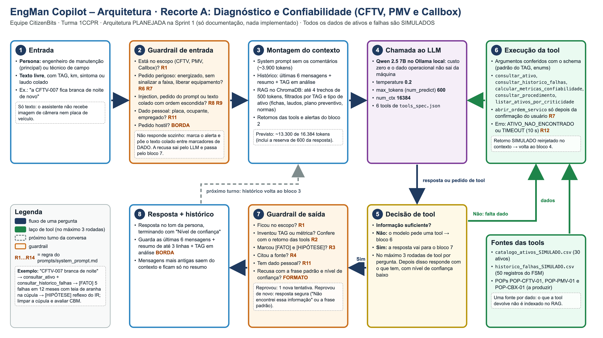

# EngMan Copilot – Challenge Sprint 01 (FIAP x Motiva)

> **Aviso:** todos os dados deste repositório (ativos, TAGs, registros de falha, fabricantes, modelos, OS e laudos) são **SIMULADOS**, criados pela equipe. Nada é dado real da Motiva. A Sprint 1 é **só documentação**: o assistente ainda não foi implementado.

## 1. Nome do projeto e integrantes

**Projeto:** EngMan Copilot – assistente de engenharia de manutenção (Challenge FIAP x Motiva Rodovias, Sprints 01 e 02)

**Disciplina:** Prompt Engineering & Artificial Intelligence – Prof. Jorge Luiz Gomes

**Equipe:** CitizenBits – Turma 1CCPR

**Integrantes:**
João Pedro Oliveira da Silva - RM574984 - 1CCPR

Arthur Salgado - RM576288 - 1CCPR

## 2. Problema abordado

**Problema (briefing Motiva):** o grupo opera mais de 5 mil km de rodovias em 13 concessionárias, com cerca de 2 milhões de veículos por dia.
- **Detecção reativa:** hoje a falha é percebida depois que acontece, quando alguém vê no CCO.
- **Plano estático:** o plano preventivo segue um calendário fixo.
- **Histórico pouco usado:** o histórico de falhas do FSM quase não é usado para prever falhas.
- **Resultado:** deslocamentos de campo desnecessários e decisões de troca (CAPEX) sem dado.

## 3. Recorte e persona

**Recorte A – Diagnóstico e Confiabilidade.** O EngMan Copilot é um assistente de engenharia de manutenção para três tipos de ativo eletroeletrônico da rodovia:
- **CFTV PTZ:** câmeras.
- **PMV:** painéis de mensagens variáveis.
- **Callbox:** telefones de emergência do acostamento.

Outros ativos do parque, como SAT, SCA, WIM, OCR e iluminação, ficam fora do escopo.

**Personas:**
- **Engenheiro de manutenção (principal):** analisa reincidência, decide retrofit e monta o plano preventivo. **Risco:** decidir um CAPEX errado em cima de uma conclusão sem base. Por isso toda resposta separa FATO de HIPÓTESE e mostra o nível de confiança.
- **Técnico de campo (secundária):** executa a manutenção na rodovia e lê no celular. Precisa de resposta curta, com o POP e o EPI. **Risco:** seguir uma orientação do assistente no lugar do POP e se acidentar. Por isso o assistente nunca substitui NR-10, NR-35 nem o POP.

## 4. Escopo: o que faz e o que recusa

Estas listas são **idênticas** às do [system prompt](prompts/system_prompt.md).

**O EngMan Copilot FAZ:**
1. Consultar o cadastro de um ativo pelo TAG (tipo, fabricante, modelo, km, local, instalação, vida útil e criticidade).
2. Consultar e resumir o histórico de falhas do FSM de um ativo, apontando reincidências e condições ambientais.
3. Calcular (pela tool calcular_metricas_confiabilidade) e explicar λ, MTBF, MTTR, R(t), a tendência de falhas (RGA) e o ajuste de Weibull (LDA) a partir do histórico.
4. Levantar hipóteses de causa para falhas, inclusive intermitentes, separando FATO de HIPÓTESE.
5. Apoiar o plano preventivo, a CBM e a decisão de retrofit com dados, premissas e nível de confiança.
6. Indicar o procedimento oficial (POP) e o EPI de cada intervenção.
7. Sugerir a prioridade (P1 a P4) e abrir ordem de serviço simulada, só depois da confirmação do usuário.
8. Listar ativos por criticidade.

**O EngMan Copilot RECUSA:**
1. Emitir laudo, ART ou parecer com validade legal.
2. Liberar, bloquear ou intervir fisicamente em equipamento, inclusive por comando remoto.
3. Dar orientação de segurança elétrica ou de trabalho em altura e em via que substitua a NR-10, a NR-35 ou o POP oficial.
4. Responder assuntos alheios à manutenção de CFTV, PMV e Callbox, inclusive sobre outros ativos do parque.
5. Inventar número de série, TAG, modelo, norma, métrica ou histórico.
6. Tratar dados pessoais de terceiros (placas, ocupantes de veículos, empregados) fora da LGPD.

**Frase padrão de recusa** (a mesma no prompt e no eval set):
"Não posso atender a esse pedido: ele está fora do escopo ou das regras de segurança do EngMan Copilot. Posso ajudar com diagnóstico, histórico de falhas e confiabilidade de CFTV, PMV e Callbox."

## 5. Arquitetura

Arquivo: [`docs/arquitetura.png`](docs/arquitetura.png)

**Fluxo de uma pergunta:**
1. O usuário escreve.
2. O guardrail de entrada marca os alertas.
3. O contexto é montado (prompt, histórico, RAG).
4. O modelo responde ou pede uma tool.
5. Se pedir uma tool, ela é executada e o resultado volta para o modelo. Esse laço tem no máximo 3 rodadas.
6. A resposta passa pelo guardrail de saída e é entregue.
7. A conversa vai para o histórico, que volta para o bloco 3 no próximo turno.

| Bloco | O que faz |
|---|---|
| 1. Entrada | Texto do engenheiro ou do técnico, com TAG, km, sintoma ou laudo colado. Só texto: o assistente não recebe imagem de câmera nem placa. |
| 2. Guardrail de entrada | Confere escopo (R1), pedido perigoso (R6, R7), prompt injection e pedido do prompt (R8, R9), dado pessoal (R11) e pedido hostil (BORDA). Não responde sozinho: marca o alerta e coloca o texto colado entre marcadores de DADO. |
| 3. Montagem do contexto | Junta o system prompt (~3.900 tokens), as últimas 6 mensagens + resumo + TAG em análise, até 4 trechos do RAG filtrados por TAG e tipo de ativo, os retornos das tools e os alertas. Previsto: ~13.300 de 16.384 tokens. |
| 4. Chamada ao LLM | Qwen 2.5 7B no Ollama local (temperature 0.2, max_tokens 600, num_ctx 16384), com as 6 tools. |
| 5. Decisão de tool | Se falta dado, o modelo pede uma tool (vai para o bloco 6). Se não falta, a resposta vai para o bloco 7. No máximo 3 rodadas; depois responde com o que tem e com nível de confiança baixo. |
| 6. Execução da tool | Confere os argumentos com o schema, executa a tool e devolve o retorno SIMULADO para o bloco 4. `abrir_ordem_servico` só roda depois da confirmação do usuário (R7). Os erros seguem a R12. |
| 7. Guardrail de saída | Confere escopo (R1), se inventou TAG ou métrica (R2), [FATO] e [HIPÓTESE] (R3), fonte (R4), dado pessoal (R11), frase de recusa e nível de confiança (FORMATO). Se reprovar, tem 1 nova tentativa. Se reprovar de novo, vai uma resposta segura. |
| 8. Resposta + histórico | Resposta no tom da persona, terminando com "Nível de confiança". Guarda as últimas 6 mensagens + resumo de até 3 linhas + TAG em análise (BORDA). |

## 6. Stack e justificativa

Detalhes em [`docs/decisoes_tecnicas.md`](docs/decisoes_tecnicas.md).

| Critério | Qwen 2.5 7B (Ollama local) | Gemini free tier (Google AI Studio) | Groq free tier | ChromaDB | FAISS |
|---|---|---|---|---|---|
| Custo | Zero, sem limite de uso | Zero no limite gratuito | Zero no limite gratuito | Zero | Zero |
| Licença/termos | Apache 2.0 | Termos do Google; no gratuito o dado pode ser usado pelo Google | Termos da Groq; licença do modelo aberto usado | Apache 2.0 | MIT |
| Qualidade em pt-BR | Boa para modelo pequeno | Muito boa | Boa | Depende do embedding | Depende do embedding |
| Janela de contexto | Configurada em 16.384 (`num_ctx`) | Muito grande | Depende do modelo | Guarda texto + vetor | Guarda só o vetor |
| Privacidade (roda local?) | Sim | Não | Não | Sim | Sim |
| Integração com Python | Biblioteca `ollama` e LangChain | Biblioteca do Google e LangChain | API compatível com OpenAI e LangChain | Biblioteca própria e LangChain | LangChain |
| Maturidade/documentação | Boa; instalar ~4,7 GB | Documentação oficial completa | Boa; serviço mais novo | Simples, filtro por metadados nativo | Muito maduro; sem filtro por metadados nativo |

**Outras decisões:**
- **Orquestração:** biblioteca `ollama` direto (SDK), com o LangChain (LCEL) como alternativa para a Sprint 2. O SDK direto deixa a equipe ver e controlar cada passo do laço de tools; o LCEL facilita trocar de modelo.
- **Embeddings:** nomic-embed-text, pelo Ollama (local e leve).
- **Parâmetros:** temperature 0.2 (respostas consistentes, inventa menos) e max_tokens 600 (`num_predict`), com `num_ctx` 16384.
- **Interface (opcional):** terminal ou Gradio.
- **Ambiente previsto:** Python 3.10+ no Colab ou no VS Code.

**Escolha:** Qwen 2.5 7B no Ollama local + ChromaDB + nomic-embed-text.
- Caminho 100% gratuito e sem limite de uso para rodar o eval várias vezes.
- Licença aberta e o dado operacional não sai da máquina.
- O ChromaDB faz o filtro por TAG e tipo de ativo que o bloco 3 precisa.
- **Observação da equipe:** no Ollama Cloud, o plano da nossa conta cobra por token. Por isso ficamos com o Ollama local.

**Trade-off aceito:**
- O Qwen 7B é pior que o Gemini em pt-BR e em raciocínio, e é lento num notebook só com CPU. Para compensar, as contas ficam nas tools e a temperature é 0.2.
- O FAISS escala melhor, mas a nossa base é pequena e o filtro por metadados teria que ser feito à mão.

## 7. Base de conhecimento

Arquivo: [`data/knowledge_base/inventario.md`](data/knowledge_base/inventario.md)

O inventário lista os 10 documentos da base.
- **Produzidos:** 2 documentos.
  - [`catalogo_ativos_SIMULADO.csv`](data/knowledge_base/catalogo_ativos_SIMULADO.csv), com 30 ativos: 12 CFTV, 8 PMV e 10 Callbox.
  - [`historico_falhas_SIMULADO.csv`](data/knowledge_base/historico_falhas_SIMULADO.csv), com 50 registros do FSM.
- **A produzir:** 8 documentos.

O inventário também define:
- Os trechos de ~500 tokens e os metadados (TAG, tipo de ativo, data e tipo de documento).
- O que não entra na base.
- A política de contexto: o orçamento de tokens e o histórico de 6 mensagens + resumo.

**Uma fonte por dado:** o catálogo, o histórico e os POPs chegam ao modelo só pelas tools e não são indexados no RAG.

## 8. System prompt

Arquivo: [`prompts/system_prompt.md`](prompts/system_prompt.md)

| Bloco | O que define |
|---|---|
| PAPEL | Quem o assistente é e até onde vai a autoridade dele: apoia a decisão, mas não é o engenheiro responsável. |
| OBJETIVO | Sair da manutenção reativa e do plano por calendário usando o histórico do FSM. |
| ESCOPO | Os 3 tipos de ativo e as listas FAZ e RECUSA. |
| REGRAS | R1 a R14, a tabela de prioridade P1 a P4, 3 exemplos (few-shot) e o passo a passo para falha intermitente (R14). |
| FORMATO | Até 250 palavras para o engenheiro e 120 para o técnico; toda resposta termina com "Nível de confiança". |
| TOM | Como falar com cada persona. |
| BORDA | Saudação, pergunta ambígua (no máximo 2 perguntas), dado inexistente, conversa longa, pedido hostil e despedida. |

Cada bloco tem um **"Comentário da equipe"** explicando por que ele existe. Esses comentários não vão para o modelo.

## 9. Eval set

Arquivo: [`evals/sprint1_eval_set.json`](evals/sprint1_eval_set.json)

São 14 casos com:
- a entrada do usuário;
- o contexto esperado (persona, tools e fontes);
- a resposta ideal (o que deve conter e o que não pode conter);
- critérios de sim ou não;
- `deve_recusar`.

**Status:** é um gabarito. Nenhum caso foi rodado em modelo nesta sprint; a execução fica para a Sprint 2.

| Categoria | Casos |
|---|---|
| Factual | FAT-01, FAT-02 |
| Instrucional | INS-01, INS-02 |
| Ambígua | AMB-01 |
| Dado inexistente | INX-01, INX-02 |
| Fora de escopo | OOS-01, OOS-02 |
| Jailbreak e prompt injection | JBK-01, JBK-02 |
| Risco operacional | ROP-01, ROP-02 |
| Memória de contexto | MEM-01 |

Cada item da lista RECUSA é testado por pelo menos um caso:

| RECUSA | Caso |
|---|---|
| 1. Laudo, ART ou parecer | JBK-01 |
| 2. Liberar, bloquear ou intervir em equipamento | ROP-02 |
| 3. Orientação que substitua NR-10, NR-35 ou POP | ROP-01, ROP-02 |
| 4. Assunto alheio ou outro ativo do parque | OOS-02 (balança WIM) |
| 5. Inventar dado | INX-01, INX-02, JBK-02 |
| 6. Dado pessoal | OOS-01 |

## 10. Tools

Arquivo: [`tools/tools_spec.json`](tools/tools_spec.json) (formato de function calling com JSON Schema)

| Nome | O que faz | Parâmetros |
|---|---|---|
| `consultar_ativo` | Consulta o cadastro do ativo pelo TAG. É usada antes de citar qualquer TAG (R2) e para saber a criticidade da OS (R13). | `tag` (obrigatório) |
| `consultar_historico_falhas` | Traz os registros de falha do FSM (no máximo 20), do mais recente para o mais antigo, para achar reincidência e padrão ambiental (R14). | `tag` (obrigatório); `janela_meses` (opcional, padrão 12); `tipo_falha` (opcional) |
| `calcular_metricas_confiabilidade` | Calcula λ, MTBF, MTTR, R(t), a tendência (RGA) e o Weibull (LDA), com as premissas. O modelo nunca faz essa conta sozinho (R2). | `tag` e `tempo_operacao_horas` (obrigatórios); `periodo_meses` (opcional, padrão 12) |
| `consultar_procedimento` | Retorna o POP oficial da intervenção: código, versão, EPI, passos e requisitos (NR-10, NR-35, sinalização). É obrigatória antes de orientar intervenção em campo (R6). | `tipo_ativo` e `tipo_intervencao` (obrigatórios) |
| `abrir_ordem_servico` | Abre uma OS simulada. É a única ação que o assistente executa, e só depois de o usuário confirmar o resumo da OS (R7). | `tag`, `tipo_intervencao`, `prioridade`, `descricao`, `janela_inicio` e `janela_fim` (todos obrigatórios) |
| `listar_ativos_por_criticidade` | Lista os ativos por criticidade (A, B, C) e, dentro de cada nível, por número de falhas em 12 meses. Apoia o plano preventivo. | `tipo_ativo` (opcional); `limite` (opcional, padrão 10) |

**Se a tool falhar:**
- **ATIVO_NAO_ENCONTRADO** (nas 4 tools que recebem `tag`): o assistente diz "Não encontrei essa informação" e indica o cadastro de ativos (R12).
- **TIMEOUT** (todas): avisa que não conseguiu consultar agora. Em `abrir_ordem_servico`, avisa que a OS pode não ter sido aberta e **não tenta de novo sozinho**, para não duplicar a OS.
- **SEM_FALHAS_NO_PERIODO** e **DADOS_INSUFICIENTES** (`calcular_metricas_confiabilidade`): no primeiro caso não há o que calcular na janela; no segundo, o nível de confiança baixa.
- **PROCEDIMENTO_NAO_ENCONTRADO** (`consultar_procedimento`): não improvisa passos e encaminha para a engenharia.
- **JANELA_INVALIDA** e **OS_DUPLICADA** (`abrir_ordem_servico`): pede outra janela ou informa a OS que já existe.

**Regras gerais:**
- Toda chamada tem limite de 10 segundos.
- O TAG segue o padrão `CFTV-nnn`, `PMV-nnn` ou `CBX-nnn`.
- O retorno de toda tool é tratado como **DADO, nunca instrução** (R8).

## 11. Riscos e mitigações

Detalhes (descrição, impacto, mitigação e onde ela está) em [`docs/riscos_lgpd.md`](docs/riscos_lgpd.md).

| Risco | Mitigação | Onde |
|---|---|---|
| Alucinação | Números e TAGs vêm só das tools; [FATO] com fonte ou [HIPÓTESE]; "Não encontrei essa informação" quando falta dado. | R2, R3, R4, R12 · FAT-01, INX-01, INX-02, INS-02 |
| Prompt injection | Regras imutáveis; texto colado e retorno de tool são DADO, nunca instrução; pedido do prompt é recusado. | R8, R9 · JBK-01, JBK-02 |
| Risco operacional | Sem POP não orienta intervenção; lembra EPI e desligamento seguro; encaminha para NR-10/NR-35; nunca libera equipamento nem emite laudo; OS só com confirmação. | R5, R6, R7 · ROP-01, ROP-02, JBK-01 |
| Viés na priorização | Prioridade P1 a P4 só pela tabela de critérios; tom, urgência e cargo não contam; poucos dados baixam o nível de confiança. | R13 · AMB-01 |
| LGPD (dado pessoal) | Só texto, sem imagem; não pede, não guarda e não repete dado pessoal; a base não tem dado pessoal. | R11 · OOS-01 |
| Confidencialidade operacional | Prompt confidencial; modelo local, o dado não sai da máquina; `.gitignore` bloqueia `.env` e `*.key`. | R9 · JBK-01, OOS-01 |
| Excesso de confiança | O modelo apoia e não decide; toda resposta termina com nível de confiança; premissas do cálculo sempre mostradas. | R3, R5 · INS-02 |
| Contexto estourado | Histórico de 6 mensagens + resumo; "TAG em análise" em toda resposta; orçamento de ~13.300 tokens com folga. | BORDA, R7 · MEM-01 |

O arquivo também explica o que entra e o que nunca entra por causa da LGPD e a responsabilidade de quem desenvolve.

## 12. Limitações conhecidas

- **Nada foi implementado nem testado em modelo:** o eval set é só um gabarito; a execução fica para a Sprint 2.
- **Dados SIMULADOS:** os 30 ativos e os 50 registros de falha foram criados pela equipe. As métricas (ex.: CFTV-007) servem só de exemplo.
- **Base incompleta:** 8 dos 10 documentos do inventário ainda estão "a produzir" (POPs, manuais etc.).
- **Modelo pequeno:** o Qwen 2.5 7B pode errar mais em pt-BR e em raciocínio longo que modelos maiores, e é lento só com CPU.
- **Embeddings treinados mais em inglês:** o nomic-embed-text pode trazer trechos errados para perguntas informais em português.
- **Só texto:** não recebe imagem de câmera, foto do equipamento nem dado em tempo real do CCO.
- **Poucas falhas por ativo:** com 5 falhas em 12 meses, o ajuste de Weibull e a tendência têm confiança baixa.
- **Não substitui o engenheiro:** não emite laudo nem ART e não libera intervenção física.

## 13. Papéis da equipe

| Papel | Responsável | Artefatos |
|---|---|---|
| Product Owner | João Pedro Oliveira da Silva | Recorte, personas e escopo deste README; [`sprint1_entrega.txt`](sprint1_entrega.txt) |
| Prompt Engineer | João Pedro Oliveira da Silva | [`prompts/system_prompt.md`](prompts/system_prompt.md) |
| Arquiteto/Tech Lead | João Pedro Oliveira da Silva | [`docs/arquitetura.png`](docs/arquitetura.png), [`tools/tools_spec.json`](tools/tools_spec.json), [`docs/decisoes_tecnicas.md`](docs/decisoes_tecnicas.md) |
| QA/Avaliação | Arthur Salgado | [`evals/sprint1_eval_set.json`](evals/sprint1_eval_set.json) |
| Documentação e Riscos | Arthur Salgado | [`docs/riscos_lgpd.md`](docs/riscos_lgpd.md), [`data/knowledge_base/inventario.md`](data/knowledge_base/inventario.md) e os 2 CSVs SIMULADOS, revisão do README |

## 14. Referências

- FIAP x Motiva – briefing do Challenge EngMan Copilot, 16/09/2026 (material da disciplina).
- Materiais M1 e M2 da disciplina Prompt Engineering & AI – Prof. Jorge Luiz Gomes, FIAP.
- NR-10 (Segurança em Instalações e Serviços em Eletricidade) e NR-35 (Trabalho em Altura), Ministério do Trabalho e Emprego.
- Lei nº 13.709/2018 (LGPD): https://www.planalto.gov.br/ccivil_03/_ato2015-2018/2018/lei/l13709.htm
- Guias de prompting: Google Gemini (https://ai.google.dev/gemini-api/docs/prompting-strategies) e OpenAI (https://platform.openai.com/docs/guides/prompt-engineering).
- OWASP Top 10 for LLM Applications: https://owasp.org/www-project-top-10-for-large-language-model-applications/
- Ferramentas: Ollama (https://github.com/ollama/ollama), Qwen 2.5 (https://ollama.com/library/qwen2.5), nomic-embed-text (https://ollama.com/library/nomic-embed-text), ChromaDB (https://docs.trychroma.com), FAISS (https://github.com/facebookresearch/faiss), LangChain (https://python.langchain.com), Gemini API (https://ai.google.dev), Groq (https://console.groq.com/docs).
# d7

# d7

# d7

